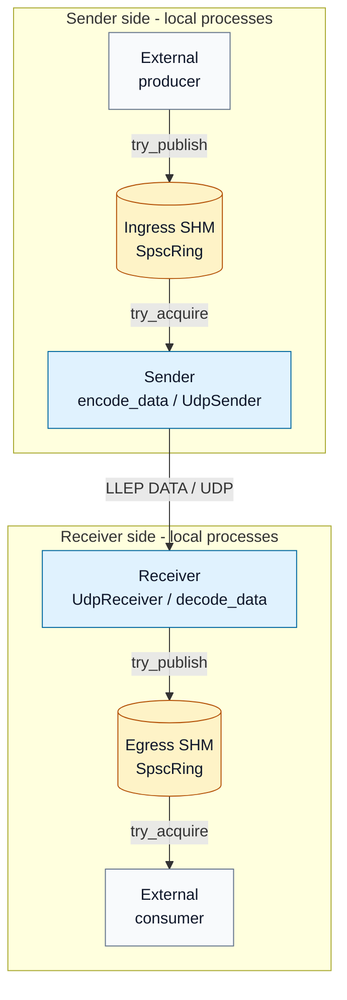
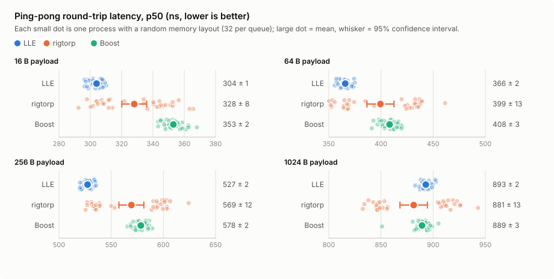
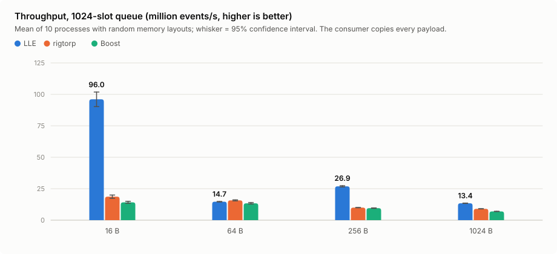

# Low-Latency Event Distribution Engine

A C++23/Linux transport for moving small opaque binary events between processes and hosts, with an emphasis on
predictable tail latency, explicit backpressure, and measurable delivery guarantees.

## Architecture

An external producer publishes events into an **ingress ring** in POSIX shared memory.
The **Sender** encodes each event as an LLEP packet and sends it over UDP to one or
more **Receivers**, which validate it and publish into an **egress ring** for the local
consumer. Key design points:

- **SPSC rings in shared memory.** One copy into the slot on publish; the consumer gets
  a zero-copy view that stays valid until it releases the slot. Release/acquire
  ordering, producer and consumer cursors on separate cache lines, each handle caching
  the other side's cursor, and ring memory aligned to 128 bytes
  ([layout and memory model](docs/memory-model.md)).
- **LLEP**, a versioned little-endian binary protocol over UDP. Packet sequence numbers
  drive gap detection and duplicate suppression ([protocol](docs/protocol.md)).
- **Explicit backpressure and accounting.** Publishing into a full ring returns `Full`
  instead of overwriting; the receiver counts drops and malformed packets.
- **Separate contracts.** The public API, the shared-memory layout, and the wire
  protocol are versioned independently, and the transport is payload-agnostic;
  application-specific integration belongs under **adapters/**.

The [architecture guide](docs/architecture.md) follows one event through the system,
explains who owns each resource and thread, and describes the sender and receiver
loops. The [data layout walkthrough](docs/data-flow.md) shows how an event becomes a
shared-memory slot and then an LLEP packet, down to the encoded bytes.

## Performance

The shared-memory SPSC ring at the core of the engine was benchmarked against
[rigtorp::SPSCQueue](https://github.com/rigtorp/SPSCQueue) and
[Boost.Lockfree `spsc_queue`](https://www.boost.org/doc/libs/release/doc/html/lockfree.html)
under identical conditions. At 16–256-byte payloads **LLE has the lowest ping-pong
latency** (p50 7–8% below rigtorp and 9–14% below Boost); at 1 KB the three are level.
**Throughput is 5.2× rigtorp's at 16 bytes, 2.7× at 256 bytes, and 1.5× at 1 KB**;
rigtorp is ahead at 64 bytes.

<picture>
  <source media="(prefers-color-scheme: dark)" srcset="figures/performance/latency-p50-dark.svg">
  
</picture>

Each small dot above is one benchmark process with its own random memory layout.
LLE's dots stay in a tight cluster, while rigtorp's split into a fast and a slow
group depending on where its queue object lands; that layout effect, and how the ring
was made immune to it, is described in the performance report.

<picture>
  <source media="(prefers-color-scheme: dark)" srcset="figures/performance/throughput-1024-dark.svg">
  
</picture>

| Payload | p50 round trip, ns LLE / rigtorp / Boost | p99 round trip, ns LLE / rigtorp / Boost | Throughput, M events/s LLE / rigtorp / Boost |
|---:|---:|---:|---:|
| 16 B | **304** / 328 / 353 | **355** / 404 / 417 | **96.0** / 18.6 / 14.2 |
| 64 B | **366** / 399 / 408 | **424** / 459 / 455 | 14.7 / **15.7** / 13.4 |
| 256 B | **527** / 569 / 578 | 624 / 637 / 637 | **26.9** / 10.0 / 9.5 |
| 1 KB | 893 / 881 / 889 | 962 / 969 / 971 | **13.4** / 9.0 / 7.0 |

Means over 32 latency processes and 10 throughput processes per case; bold marks the
best value where its 95% confidence interval does not overlap the others. Measured on
an Intel Core i7-10750H laptop with the benchmark threads on isolated, tickless cores
at a fixed 2.6 GHz; round trips are not halved. Method, confidence intervals, tail
percentiles, caveats, and the exact command are in the
[performance report](docs/performance.md); the raw dataset is in
[results/representative](results/representative/2026-10-16-spsc/).

Design choices whose effect was measured in A/B runs
([engineering record](docs/performance.md#engineering-record-spsc-ring-hot-path)):
each handle caches the other side's cursor instead of reading it on every operation,
the per-event hot path is inline in the header, handles are cache-line aligned, and
ring memory starts on a 128-byte boundary so the producer and consumer cursors never
share a prefetched line pair.

## Status

Implemented and tested:

- POSIX shared-memory creation, attachment, mapping, close, and owner-controlled unlink.
- SPSC ring: versioned layout, checked initialization and attachment, publication,
  acquisition, explicit release, full/empty detection, slot reuse, and draining after
  publication closure.
- Single-event LLEP DATA encoding and decoding, and a reusable UDP transport.
- A library sender (ingress ring -> LLEP DATA -> serial UDP fan-out) and receiver
  (UDP -> validation -> egress ring) with drop and malformed-packet accounting, plus
  byte-identical fan-out to 1, 2, and 4 receiver processes.
- Packet sequencing with exact missing ranges, gap counters, and duplicate/old-packet
  suppression.
- 131 GoogleTest unit, integration, and multi-process tests (including a 10-million-event
  transfer between two processes), clean under ASan/UBSan and TSan.
- Reproducible SPSC latency and throughput benchmarks against rigtorp and Boost
  ([benchmark guide](benchmarks/micro/README.md), [recorded runner](scripts/bench/README.md)).

Not implemented yet:

- LLEP batching of several events per DATA packet: specified in the
  [protocol](docs/protocol.md); the decoder currently rejects batched packets.
- NACK-based retransmission and ordered recovery: specified; the retransmit window and
  reorder buffer are still stubs.
- Sender and receiver executables: the library loops exist, the `lle-sender` and
  `lle-receiver` programs are scaffolding.
- End-to-end (shared memory -> UDP -> shared memory) latency and throughput benchmarks.

## Command-line build

    cmake --preset dev
    cmake --build --preset dev
    ctest --preset dev

Sanitizer configurations use separate build trees:

    cmake --preset asan && cmake --build --preset asan && ctest --preset asan
    cmake --preset tsan && cmake --build --preset tsan && ctest --preset tsan -E 'SeparateMapping|SeparateProcesses'

See [testing instructions](docs/testing.md) for integration tests, sanitizer coverage, and the
TSan launcher required when running directly from CLion.

## Documentation

| Document | Contents |
|---|---|
| [Architecture](docs/architecture.md) | data path, event sequence, ownership, sender and receiver loops |
| [Data flow](docs/data-flow.md) | how an event maps onto a ring slot and an LLEP packet, with bytes |
| [Memory model](docs/memory-model.md) | shared-memory layout, cache-line placement, ordering rules |
| [Protocol](docs/protocol.md) | LLEP wire format, including the planned batching and NACK messages |
| [Testing](docs/testing.md) | test map, sanitizer runs, multi-process tests |
| [Performance](docs/performance.md) | representative results, method, and the optimization record |
| [Benchmarks](benchmarks/micro/README.md), [runner](scripts/bench/README.md) | how to run and reproduce the benchmarks |

CMake targets

- **lle**: static library and public headers;
- **lle-sender**: sender process entry point;
- **lle-receiver**: receiver process entry point;
- **lle-udp-smoke**: standalone UDP smoke program;
- **lle-smoke-test**: minimal CTest target validating the toolchain and public types.
- **lle-byte-io-test**, **lle-encoder-test**, **lle-decoder-test**: single-event protocol unit tests;
- **lle-shm-segment-test**: shared-memory lifecycle tests;
- **lle-ring-init-test**: ring layout, initialization, and attachment tests;
- **lle-ring-transfer-test**: publication, acquisition, release, closure, and boundary tests;
- **lle-ring-concurrency-test**: thread and process integration tests;
- **lle-udp-transport-test**: loopback UDP and protocol transport integration;
- **lle-sender-test**: ingress SHM to UDP sender integration and failure handling.
- **lle-receiver-test**: UDP to egress SHM receiver integration and the complete local data path.
- **lle-spsc-benchmark**: optional Release throughput/RTT comparison, enabled with `LLE_BUILD_BENCHMARKS=ON`.
- **lle-spsc-latency**: optional Release ping-pong latency benchmark (rdtsc, all percentiles), same option.

