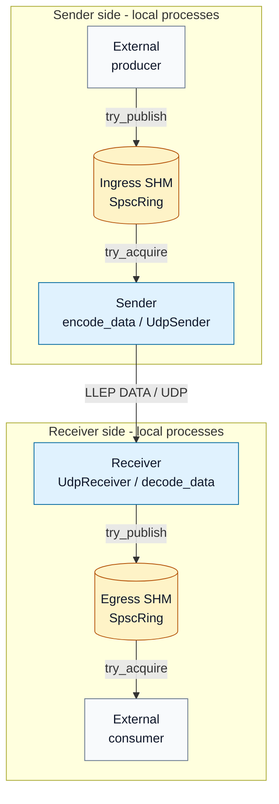
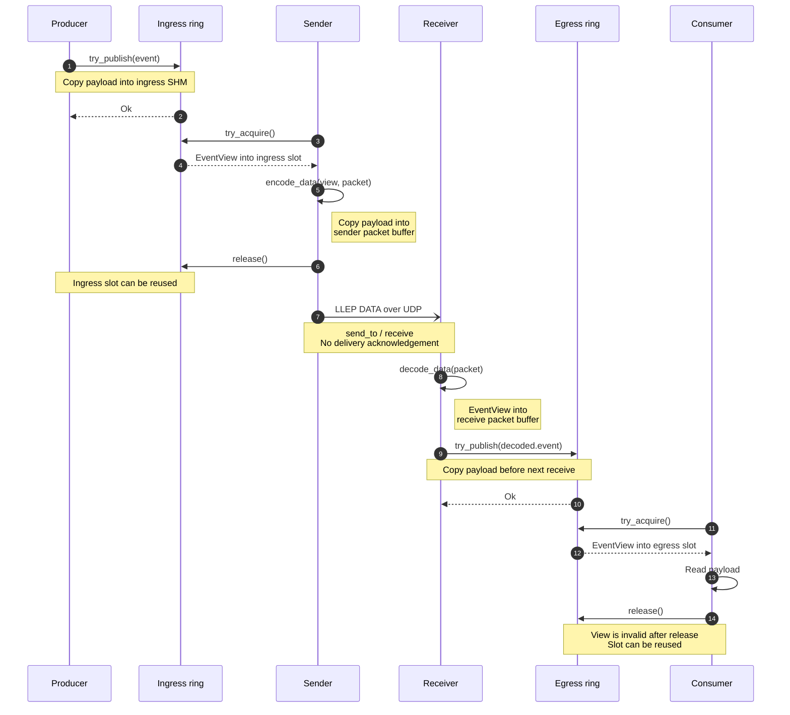

# Architecture

Start with the component map, then follow one event in the sequence diagram. The
diagrams describe the current library implementation: one event per DATA packet,
one receiver destination, and BestEffort delivery. Sender and receiver executables
are still scaffolds; the integration tests connect the library components.

## Current data path

Ingress is the queue **entering the sender**; egress is the queue **leaving the
receiver**. SHM means shared memory on one host. SPSC means that each ring has
exactly one producer and one consumer. Arrows below show where event data goes;
the sequence diagram below shows who calls each method.



[Mermaid source](../figures/current-data-path.mmd) · [PNG preview](../figures/current-data-path.png)

Both sides can run on one host using loopback UDP, as in the current integration
tests. Across hosts, only UDP crosses the network; each SHM segment stays local.
LLEP is the binary format of the UDP datagram, not another process or queue.
The producer and consumer supply application logic; the engine treats payloads as
opaque bytes.

| Component | Responsibility | Code to read |
|-----------|----------------|--------------|
| `EventView` | Event metadata and a non-owning payload view | [event.hpp](../include/lle/event.hpp) |
| `SharedMemorySegment` | Create, attach, map, close, and unlink SHM | [segment.cpp](../src/shm/segment.cpp) |
| `SpscRing` | Publish, acquire, release, and close an event queue | [spsc_ring.cpp](../src/shm/spsc_ring.cpp) |
| `Sender` | Read ingress, encode, release its slot, and send UDP | [sender.cpp](../src/sender/sender.cpp) |
| `Receiver` | Receive UDP, validate DATA, and publish to egress | [receiver.cpp](../src/receiver/receiver.cpp) |
| Protocol helpers | Convert between event data and LLEP bytes | [encoder.cpp](../src/protocol/encoder.cpp), [decoder.cpp](../src/protocol/decoder.cpp) |
| UDP transport | Own sockets and send/receive datagrams | [udp_sender.cpp](../src/transport/udp_sender.cpp), [udp_receiver.cpp](../src/transport/udp_receiver.cpp) |

## How the data layout changes

The [data representation walkthrough](data-flow.md) follows `EventView` into an
ingress SHM slot, through LLEP encoding and decoding, and into egress SHM. It shows
the 32-byte SHM slot header, the 16-byte DATA header, 20-byte DATA information,
6-byte event-frame header, byte offsets, and the functions that write each part.
The worked example compares a 64-byte SHM slot with a 48-byte LLEP packet carrying
the same three payload bytes.

## One event from producer to consumer

This is the successful path with free ring slots and a valid event. Dashed arrows
are local API results. The UDP arrow is a transmission, with no delivery
acknowledgement. Sender and receiver run independently.



[Mermaid source](../figures/event-sequence.mmd) · [PNG preview](../figures/event-sequence.png)

`EventView` owns no payload memory. `try_acquire()` and `decode_data()` return
views without copying payload bytes. The application-level copies are into
ingress SHM, into the sender's encoded packet, and into egress SHM; normal UDP
socket processing also transfers bytes through the kernel. Sender can release
ingress before `send_to()` because encoding has already copied the payload into
its own packet buffer. Receiver must publish before the next receive overwrites
the buffer referenced by its decoded view. Consumer must finish reading before
releasing its egress slot.

The original `stream_id`, event `sequence`, timestamp, and payload survive the
encode/decode path. Sender adds a separate `session_id` and `packet_sequence` to
the LLEP packet. These transport fields are not stored in SHM event slots. Receiver
does not yet use them for gap detection, reordering, or duplicate suppression.

## Resource and thread ownership

| Resource | Creates and initializes it | Writes / reads it | Cleanup |
|----------|----------------------------|-------------------|---------|
| Ingress SHM | External producer | Producer writes; Sender reads | Producer closes publication and unlinks the name; Sender only closes its attachment |
| Egress SHM | `Receiver::initialize()` | Receiver writes; external consumer reads | Receiver closes publication when `run()` returns and unlinks the name on destruction |
| Sender packet buffer | `Sender::run()` | Encoder writes; `UdpSender` sends | Local buffer lives until `run()` returns |
| Receiver packet buffer | `Receiver::run()` | `UdpReceiver` writes; decoder and publisher read | Local buffer lives until `run()` returns |

Create and initialize ingress before attaching Sender. Initialize Receiver before
attaching the egress consumer. Each participant uses its own ring handle and keeps
its SHM mapping alive while accessing the ring or a view. Publication and slot
reuse use release/acquire cursor synchronization; see the [memory model](memory-model.md).

The library does not start threads itself: the application calls each `run()` on
one worker thread. Another thread may call `request_stop()`; the stop flag is
atomic. Stop and join the worker before reading `stats()`, moving,
or destroying that engine object. Receiver uses a 10 ms receive timeout to notice
stop requests when UDP is idle. It closes egress publication before returning,
allowing Consumer to drain queued events and then observe `AcquireError::Closed`.
Sender drains a closed ingress, while `request_stop()` may leave queued ingress
events unconsumed. Closing ingress does not send a remote stop command to Receiver.

## Boundary

The engine boundary includes shared-memory ingress/egress, transport framing,
backpressure, and metrics. UDP fan-out and optional bounded recovery extend this
boundary in later steps. External producers and consumers own application semantics.

## Later steps

- receiver packet sequencing with gap and duplicate accounting;
- serial-unicast UDP fan-out to multiple receivers;
- opportunistic batching;
- CPU affinity and receive-mode experiments;
- optional NACK, retransmission history, and bounded reorder window.

The diagrams above cover the implemented path. Batching, fan-out, receiver gap and
duplicate accounting, NACKs, retransmission, and ordered recovery remain later steps.

## Hot-path implementation constraints

The LLEP wire layout permits allocation-free processing; the engine makes that an implementation requirement. After initialization, the steady-state packet encoder and decoder MUST NOT dynamically allocate while processing packets or events. Packet buffers, decoded-view storage, and other bounded working memory are allocated before entering the hot path and then reused.

Transmit and receive packet buffers MUST begin at an address aligned to at least 8 bytes. For fixed local buffers, one suitable declaration is:

```cpp
alignas(8) std::array<std::byte, MAX_LLEP_PACKET_BYTES> buffer;
```

This base alignment allows the naturally aligned offsets defined by LLEP to produce aligned integer addresses. Decoders still use explicit byte-order helpers and MUST NOT rely on casting packet bytes to native C++ structures.

## Basic sender loop

`Sender::initialize(config)` attaches to an existing, initialized ingress segment,
attaches its consumer ring handle, parses one numeric IPv4 destination, opens the
UDP socket, and chooses a nonzero random session ID. Startup failures return
`InitError`. The external producer owns initialization and unlinking of ingress SHM.
The sender owns its attachment and socket through the existing resource classes.

The loop is deliberately small:

```text
try_acquire -> encode one DATA packet -> release -> send_to
```

`run()` reuses an aligned, fixed-size packet buffer. The configured datagram limit
bounds the encoder's output, including padding. Event metadata and payload bytes
come directly from the acquired ring view; the view remains valid until release.
Encoding copies the payload into the packet buffer, so the loop releases the
ingress slot before the socket send.
Packet sequences start at 1 and advance for each encoded packet, even if sending
fails. Invalid events do not consume a packet sequence. The sender stops before
packet sequence overflow; a new sender instance starts a new session.

BestEffort consumes and counts events that fail encoding or sending, then continues
with the next slot. This prevents an unsendable event from blocking the queue.
`events_in` counts acquired events; `events_out` and `packets_sent` count successful
socket sends, which do not guarantee remote delivery. `events_dropped`,
`encode_errors`, and `send_errors` record failed attempts. An invalid ring slot
increments `ingress_errors` and stops the loop because it cannot be safely acquired.

An empty ring is polled continuously when `busy_spin_ingress` is true. When false,
the loop sleeps for 1 ms between empty polls, trading latency for lower CPU use.
Closing publication drains queued events before `run()` returns. Calling
`request_stop()` from another thread finishes any acquired event and leaves the
remaining queue untouched. Read `stats()` after `run()` returns, joining its worker
thread first. Moving or destroying the sender also requires that worker to be stopped.

This milestone supports one destination and BestEffort delivery with `cpu == -1`.
Initialization rejects unsupported settings. Fan-out, affinity,
and loss recovery remain later plan steps. The command-line sender is still a scaffold;
the working sender loop is available through the library API.

Example, after the external producer has created and initialized `/my-ingress`:

```cpp
lle::SenderConfig config;
config.ingress_shm_name = "/my-ingress";
config.receivers.push_back({"127.0.0.1", 9000});
auto sender = lle::Sender::initialize(config);
if (!sender) {
    // Report sender.error() during startup.
    return;
}
sender->run(); // Returns after ingress closes and drains, or request_stop().
const auto stats = sender->stats();
```

## Basic receiver loop

`Receiver::initialize(config)` validates the egress ring configuration, parses and
binds the numeric IPv4 listen endpoint, creates egress SHM, and initializes its
producer ring handle with a random nonzero instance ID. The receiver owns this
segment and unlinks its name on destruction. The consumer may attach only after
initialization succeeds. A socket bind failure creates no SHM; an existing segment
with the requested name is never replaced or unlinked.

The loop uses the existing transport, decoder, and ring:

```text
receive UDP -> decode one DATA packet -> try_publish to egress
```

`run()` reuses an aligned, fixed-size packet buffer. The decoder returns a payload
view into that buffer; `try_publish()` copies the event into SHM before the next
receive can overwrite the buffer. Malformed, empty, truncated, and oversized
datagrams increment `malformed_packets` and are never published. `packets_received`
includes consumed oversized datagrams. `events_in` counts valid decoded events;
`events_out` counts successful egress publications.

BestEffort drops an event when egress is full, incrementing `egress_full` and
`events_dropped`, and continues receiving. A payload larger than the configured slot
capacity increments `egress_errors` and `events_dropped`. A closed or unusable ring
also increments those counters and stops the loop. Socket errors increment
`receive_errors` and stop; receive timeouts and interrupted syscalls are retried.
Malformed packet counts are kept separate from dropped event counts because their
event metadata cannot be trusted.

The receive call uses a 10 ms poll timeout so `request_stop()` can terminate an idle
receiver. Data wakes the poll immediately. A datagram already received is processed
before stopping. Before returning, `run()` closes egress publication; the consumer
can drain queued events and then observe `AcquireError::Closed`. Stop and join the
worker before reading stats, moving, or destroying the receiver. Destruction also
closes publication when `run()` was never called. Existing consumer mappings remain
usable after the segment name is unlinked.

This step supports one event per DATA packet in BestEffort mode, with `cpu == -1`
and `busy_poll_us == 0`. An empty listen address means `0.0.0.0`; a zero listen port
requests an ephemeral port exposed through `local_port()`. Sequencing, duplicate/gap
accounting, affinity, busy polling, and recovery remain separate plan steps. The
command-line receiver is still a scaffold; the implementation is available through
the library API.

Example receiver configuration:

```cpp
lle::ReceiverConfig config;
config.listen = {"0.0.0.0", 9000};
config.egress_shm_name = "/my-egress";
config.egress_ring = {1024, 1374};

auto receiver = lle::Receiver::initialize(config);
if (!receiver) {
    // Report receiver.error() during startup.
    return;
}
receiver->run(); // Another thread calls request_stop() to end reception.
const auto stats = receiver->stats();
```
