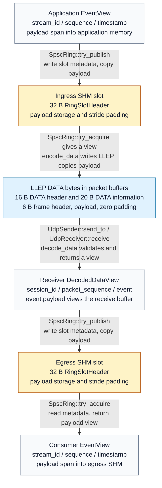
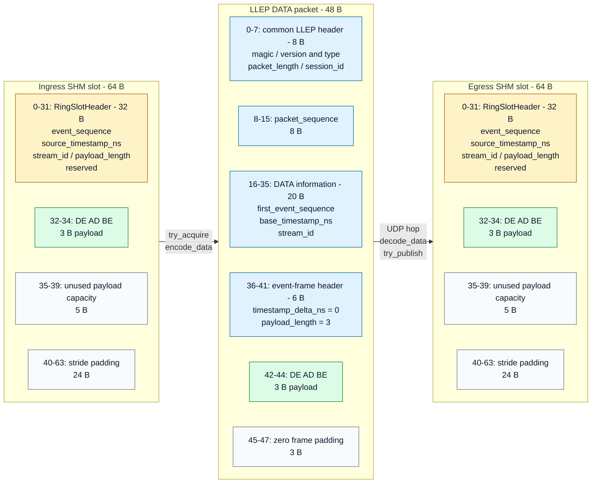

# Event data: from an application view to SHM and UDP

This walkthrough follows the current successful single-event DATA path. A slot is
the SHM queue's storage unit; an event frame is the LLEP packet's storage unit.
The payload bytes keep their values while the surrounding metadata changes layout.

## Representations and functions



[Mermaid source](../figures/data-representation-flow.mmd) · [PNG preview](../figures/data-representation-flow.png)

| Step | Function and code | What happens to the bytes |
|------|-------------------|---------------------------|
| Application event | [EventView](../include/lle/event.hpp) | Holds metadata values and a `std::span` referring to application payload memory. Creating the view does not copy the payload. |
| Ingress publication | [SpscRing::try_publish()](../src/shm/spsc_ring.cpp) | `fill_slot_header()` writes event metadata and payload length. `std::ranges::copy()` writes the active payload at slot offset 32. |
| Sender acquisition | [SpscRing::try_acquire()](../src/shm/spsc_ring.cpp) | Reads metadata into a new `EventView`; its payload span points into the ingress slot. |
| Packet encoding | [encode_data()](../src/protocol/encoder.cpp) | `write_u16/u32/u64()` encode little-endian fields. The payload is copied to packet offset 42; frame padding is filled with zeroes. |
| UDP hop | [UdpSender::send_to()](../src/transport/udp_sender.cpp), [UdpReceiver::receive()](../src/transport/udp_receiver.cpp) | `sendto()` sends the used packet bytes; `recvmsg()` writes the UDP payload into a separate receiver buffer. The OS adds and removes outer UDP/IP headers. |
| DATA decoding | [decode_data()](../src/protocol/decoder.cpp) | Validates fields, lengths, and padding; reads metadata with byte-order helpers and returns `DecodedDataView`. Its event payload is `packet.subspan(42, payload_length)`. |
| Egress publication | [SpscRing::try_publish()](../src/shm/spsc_ring.cpp) | Writes a SHM slot header from `decoded.event` and copies the payload into egress storage. |
| Consumer acquisition | [SpscRing::try_acquire()](../src/shm/spsc_ring.cpp) | Returns an `EventView` pointing into the egress slot. |

Sender releases ingress after encoding and before sending: the encoded packet
already owns a copy of the payload. Receiver publishes before its next receive can
overwrite the decoded view's buffer. Consumer reads its view before releasing the
egress slot. See the [sequence diagram](architecture.md#one-event-from-producer-to-consumer)
for the call order.

## SHM: one segment header, then fixed-size slots

`SharedMemorySegment::create_shm()` creates and maps storage;
`SpscRing::initialize()` constructs its ring layout once. Each segment contains:

```text
RingHeader: 192 B
  RingPreamble: 64 B | producer cursor: 64 B | consumer cursor: 64 B
Slot 0: slot_stride B
Slot 1: slot_stride B
...
```

The segment header contains layout/version information, the ring `instance_id`,
state, and queue cursors. It stays local to that SHM segment. Every event slot has
its own 32-byte `RingSlotHeader`, followed by payload storage. Ingress and egress
use this same layout, with independently configured capacities.

All offsets below are relative to a slot's beginning. The SHM fields use native
integer representation; this ABI requires little-endian hosts.

| Slot offset | Size | Field | Source |
|------------:|-----:|-------|--------|
| 0 | 8 B | `event_sequence` | `event.sequence` |
| 8 | 8 B | `source_timestamp_ns` | `event.source_timestamp_ns` |
| 16 | 4 B | `stream_id` | `event.stream_id` |
| 20 | 4 B | `payload_length` | `event.payload.size()` |
| 24 | 8 B | Two reserved `u32` values | Zeroed when the slot header is initialized |
| 32 | `slot_payload_capacity` B | Payload storage | Only the first `payload_length` bytes contain the current payload |
| After payload storage | Variable | Stride padding | Rounds the slot size to a 64-byte boundary |

```text
slot_stride = align_up(32 + slot_payload_capacity, 64)
segment_bytes = 192 + slot_count * slot_stride
```

`try_acquire()` constructs a process-local span pointing to `slot + 32`. Each
process computes that address from its own mapping; pointers and `std::span`
objects are never serialized into the slot. SHM unused capacity and stride padding
are outside the active payload and may contain old bytes.

## LLEP: rebuild metadata and add transport identity

`encode_data()` reads the acquired event's field values and writes the LLEP layout
into Sender's packet buffer. The packet consists of a 16-byte DATA header, 20 bytes
of DATA-level information, and one event frame. The event frame contains a 6-byte
header, payload, and zero padding.

All offsets in this table are relative to the LLEP packet's beginning. Multi-byte
values are explicitly written little-endian.

| Packet offset | Size | Field | Value in the current single-event path |
|--------------:|-----:|-------|----------------------------------------|
| 0 | 1 B | `magic` | `0x4c` |
| 1 | 1 B | version/type | `0x11`: version 1, DATA type 1 |
| 2 | 2 B | `packet_length` | Complete LLEP byte count, including frame padding |
| 4 | 4 B | `session_id` | Chosen once by `Sender::initialize()` |
| 8 | 8 B | `packet_sequence` | Sender's current packet sequence |
| 16 | 8 B | `first_event_sequence` | `event.sequence` |
| 24 | 8 B | `base_timestamp_ns` | `event.source_timestamp_ns` |
| 32 | 4 B | `stream_id` | `event.stream_id` |
| 36 | 4 B | `timestamp_delta_ns` | Zero for the first and only event |
| 40 | 2 B | `payload_length` | `event.payload.size()`, bounded by 1,374 B |
| 42 | `payload_length` B | Payload | The active payload bytes, unchanged |
| After payload | 0-3 B | Frame padding | Zeroes rounding the frame size to 4 B |

The first 8 bytes are the common LLEP header; adding `packet_sequence` makes the
DATA header 16 bytes. `first_event_sequence`, `base_timestamp_ns`, and `stream_id`
make up the next 20 bytes. The event-frame header at offset 36 contains only
timestamp delta and payload length. The original sequence, timestamp base, and
stream are carried in DATA-level information.

```text
frame_bytes = align_up(6 + payload_length, 4)
packet_bytes = 36 + frame_bytes
```

Sender supplies packet identity separately from application metadata. The ring's
`instance_id` identifies SHM storage; the sender's `session_id` identifies its
network session. SHM reserved fields, unused capacity, stride padding, and cursors
remain local. `packet_length` covers only the encoded LLEP bytes; the kernel's
outer UDP/IP headers sit outside that count.

## Decode back into an event and publish to egress

`decode_data()` returns packet identity alongside `decoded.event`. For the current
single-event packet, the event sequence is `first_event_sequence`, the timestamp
is `base_timestamp_ns`, and the frame's required timestamp delta is zero. The
event's payload is a view of the received packet's bytes beginning at offset 42.

| Event data | Ingress SHM | LLEP packet | Egress SHM |
|------------|-------------|-------------|------------|
| Sequence | Slot offset 0, `u64` | Offset 16, `first_event_sequence` | Slot offset 0, `u64` |
| Timestamp | Slot offset 8, `u64` | Offset 24, base; offset 36, zero delta | Slot offset 8, `u64` |
| Stream | Slot offset 16, `u32` | Offset 32, `u32` | Slot offset 16, `u32` |
| Payload length | Slot offset 20, `u32` | Offset 40, `u16` | Slot offset 20, `u32` |
| Payload bytes | Slot offset 32 | Packet offset 42 | Slot offset 32 |

`Receiver::run()` passes `decoded.event` to the egress ring. The ring writes event
metadata and payload using its own slot layout. LLEP headers and packet identity
stay outside egress slots; Consumer acquires the original application-level
metadata and payload bytes from SHM.

## Worked example: three payload bytes

Take a three-byte payload, `DE AD BE`, and an eight-byte payload capacity in both
SHM rings. Each slot occupies 64 bytes: 32 bytes of header, 8 bytes of payload
storage, and 24 bytes of stride padding. Only three of the eight payload-storage
bytes are active. A two-slot segment occupies `192 + 2 * 64 = 320` bytes.

Encoding builds a 48-byte packet: 36 fixed bytes and a 12-byte frame containing
6 bytes of frame header, 3 bytes of payload, and 3 bytes of zero padding. The
sender's allocated packet buffer is larger, but `send_to()` sends only those
48 encoded bytes. This example gives egress the same capacity as ingress;
production configurations may choose different capacities.



[Mermaid source](../figures/data-layout-example.mmd) · [PNG preview](../figures/data-layout-example.png)

Offsets in this diagram are relative to each slot or packet, and the blocks are
schematic rather than proportional. Green blocks contain the same three payload
bytes at each stage. SHM's unused storage stays local; LLEP frame padding is sent
as part of the packet and excluded from the decoded payload.

### Exact packet bytes from the encoder test

[EncoderTest.EncodesKnownSingleEventPacket](../tests/unit/encoder_test.cpp) uses
these deliberate byte patterns to make little-endian encoding visible:

```text
stream_id           = 0x31323334
sequence            = 0x1112131415161718
source_timestamp_ns = 0x2122232425262728
payload             = DE AD BE
session_id          = 0x01020304
packet_sequence     = 0x0102030405060708
```

Its expected 48-byte packet is:

```text
offset  bytes (hex)
0x0000  4c 11 30 00 04 03 02 01 08 07 06 05 04 03 02 01
0x0010  18 17 16 15 14 13 12 11 28 27 26 25 24 23 22 21
0x0020  34 33 32 31 00 00 00 00 03 00 de ad be 00 00 00
```

At offset 2, `30 00` represents length 48. At offset 40, `03 00` represents payload
length 3. The payload begins at offset 42; the final three zeroes are frame padding.
The SHM example uses those same event values and an illustrative capacity of 8 B;
the encoder test itself validates the packet bytes without creating a ring.

For the complete contracts, see the [SHM memory model](memory-model.md) and
[LLEP specification](protocol.md). Batching and recovery remain later steps;
these diagrams describe the current one-event encoder and decoder.
