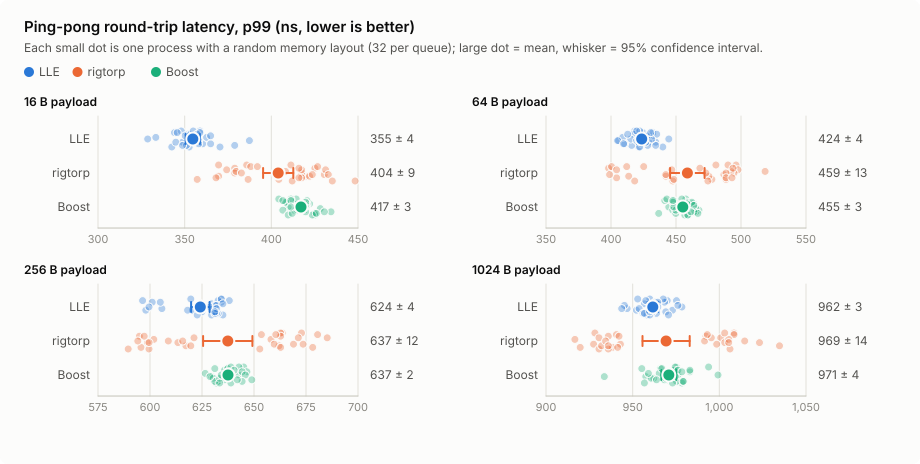

# Performance report

All numbers come from the benchmark output; nothing is estimated. The representative
dataset is committed under [results/representative/2026-10-16-spsc](../results/representative/2026-10-16-spsc/)
with its report, manifest, exact command, and per-process measurements. Charts are
generated from it by [plot_results.py](../scripts/analysis/plot_results.py).

## Representative results: SPSC queues on isolated cores

### Method

- **Workloads.** `lle-spsc-latency`: ping-pong round trip between two threads, one
  request outstanding, payload copied by both sides; `lle-spsc-benchmark`: one-way
  throughput, the consumer copies every payload. LLE `SpscRing`, rigtorp
  `SPSCQueue`, and Boost `lockfree::spsc_queue` run through identical adapters.
  See the [benchmark guide](../benchmarks/micro/README.md).
- **Machine.** Intel Core i7-10750H laptop on AC power, Linux 7.0.0-34-generic,
  GCC 15.2.0 `-O3 -DNDEBUG`, commit `ce4ae8d`, clean tree. Benchmark threads pinned
  to CPUs 2 and 4 (separate physical cores) with `isolcpus`, `nohz_full`, `rcu_nocbs`
  and `irqaffinity` keeping the scheduler, the timer tick, and interrupts off them.
  `performance` governor, turbo off (TSC 2592 MHz), SMT off. No thermal throttling
  during the run. One checklist item was not met: `gnome-shell` (9.7%) and
  `localsearch-ext` (6.4%) were the busiest background processes.
- **Memory layout.** Latency on this CPU depends on where queue state falls within a
  page (see section 6 below), and ASLR only moves whole pages. Every case therefore
  runs in many separate processes; each process places every queue object and buffer
  at a random multiple of that queue's own alignment within a page (LLE: 128 bytes,
  which its ring requires; rigtorp and Boost: 64 bytes).
- **Statistics.** Latency: 32 processes per case, 2,000,000 round trips each after
  200,000 warm-up. Throughput: 10 processes per case. Tables give the mean over
  processes with a 95% confidence interval (Student t). Round-trip times include one
  fenced `rdtsc` pair (median 17.0 ns) and are not halved.
- **Reproduce.** `sudo scripts/bench/tune.sh apply`, then
  `LLE_PROCESSES=32 LLE_THROUGHPUT_PROCESSES=10 scripts/bench/run_clean.sh`; see
  [scripts/bench](../scripts/bench/README.md).

### Latency

<picture>
  <source media="(prefers-color-scheme: dark)" srcset="../figures/performance/latency-p50-dark.svg">
  
</picture>

<picture>
  <source media="(prefers-color-scheme: dark)" srcset="../figures/performance/latency-p99-dark.svg">
  
</picture>

Round-trip latency in ns, mean ± 95% CI over 32 processes:

| Payload | Queue | p50 | p99 | p99.9 |
|---:|---|---:|---:|---:|
| 16 B | LLE | **304 ± 1** | **355 ± 4** | **386 ± 6** |
| 16 B | rigtorp | 328 ± 8 | 404 ± 9 | 429 ± 9 |
| 16 B | Boost | 353 ± 2 | 417 ± 3 | 439 ± 4 |
| 64 B | LLE | **366 ± 2** | **424 ± 4** | **451 ± 4** |
| 64 B | rigtorp | 399 ± 13 | 459 ± 13 | 487 ± 11 |
| 64 B | Boost | 408 ± 3 | 455 ± 3 | 470 ± 3 |
| 256 B | LLE | **527 ± 2** | 624 ± 4 | 646 ± 4 |
| 256 B | rigtorp | 569 ± 12 | 637 ± 12 | 670 ± 12 |
| 256 B | Boost | 578 ± 2 | 637 ± 2 | 666 ± 3 |
| 1024 B | LLE | 893 ± 2 | 962 ± 3 | 999 ± 5 |
| 1024 B | rigtorp | 881 ± 13 | 969 ± 14 | 1017 ± 17 |
| 1024 B | Boost | 889 ± 3 | 971 ± 4 | 1012 ± 7 |

Median p99.99 across processes: 411, 478, 669, and 1025 ns for LLE at 16, 64, 256,
and 1024 bytes (rigtorp 460, 526, 701, 1059; Boost 449, 486, 687, 1038).

- At 16–256 bytes LLE has the lowest p50, with confidence intervals that do not
  overlap the baselines: 7.3%, 8.3%, and 7.4% below rigtorp and 13.9%, 10.3%, and 8.8%
  below Boost. Its p99 is lowest at 16 and 64 bytes. At 1024 bytes the three queues
  are level.
- LLE's spread across layouts is narrow (16 B p50: 296–310 ns over 32 processes);
  rigtorp's is wide (292–366 ns). In its best layouts rigtorp matches LLE; its mean
  is higher because roughly half of the layouts are slow (section 6).

### Throughput

<picture>
  <source media="(prefers-color-scheme: dark)" srcset="../figures/performance/throughput-1024-dark.svg">
  
</picture>

Million events per second, 1024 slots, mean ± 95% CI over 10 processes:

| Payload | LLE | rigtorp | Boost |
|---:|---:|---:|---:|
| 16 B | **96.04 ± 5.78** | 18.64 ± 1.29 | 14.15 ± 0.78 |
| 64 B | 14.67 ± 0.20 | **15.71 ± 0.41** | 13.38 ± 0.59 |
| 256 B | **26.89 ± 0.50** | 9.95 ± 0.10 | 9.54 ± 0.16 |
| 1024 B | **13.41 ± 0.14** | 9.01 ± 0.07 | 6.95 ± 0.12 |

- LLE delivers about 5.2×, 2.7×, and 1.5× rigtorp's throughput at 16, 256, and 1024
  bytes; rigtorp is ahead at 64 bytes.
- Results for 64 and 16384 slots are in the dataset's report. With 64 slots, LLE at
  16 bytes is bimodal across processes (24.34–56.49 M events/s) and is not quoted.

### Caveats

- One laptop CPU (Comet Lake). Cache-line pairing and coherence costs differ on
  other microarchitectures and on multi-socket servers.
- Both threads live in one process; the queues are not exercised across processes
  here, although LLE's ring is designed for shared memory.
- Ping-pong is closed-loop: it measures an idle queue's round trip, not latency under
  sustained or bursty load.
- LLE's ring requires 128-byte-aligned memory, which a shared-memory mapping always
  provides; the baselines are placed according to their own 64-byte alignment.

## Engineering record: SPSC ring hot path

Exploratory, same-session A/B comparisons that led to the current design. Sections 1–3
were measured on a non-isolated laptop with an IDE running; later sections note their
own conditions. Only the representative results above are suitable for quoting.

### Environment and method (sections 1–3)

- Intel Core i7-10750H (6 cores / 12 threads), Linux 7.0.0-27-generic, GCC 15.2.0,
  CMake Release (`-O3 -DNDEBUG`).
- `powersave` governor (intel_pstate), turbo on, SMT on, no `isolcpus`; an IDE
  was running in the background. ASLR disabled for the benchmark process.
- Throughput: `lle-spsc-benchmark`, 1024 slots, `--benchmark_min_time=1s`,
  5 repetitions, reported as median (min–max). Its consumer reads only the sequence
  number, so large-payload throughput mostly measures producer-side copying.
- Latency: `lle-spsc-latency` ping-pong round trip, 10M samples after 1M warm-up
  per run, two runs per variant, reported as the min–max of the per-run
  percentile. See the [benchmark guide](../benchmarks/micro/README.md).
- All three queues run inside the same executable, so each variant treats them
  identically. Variants were run interleaved in one session; numbers from
  different sessions are not comparable.
- After every change, all 131 tests pass under ASan+UBSan and under TSan.

### 1. Cached peer cursor and ring geometry — kept

Each `SpscRing` handle keeps a private copy of the other side's cursor and reloads
it only when that copy says the ring is full (producer) or empty (consumer). Slot
count, stride, and payload capacity are copied once when the handle is created
instead of being reread from shared memory on every operation. See
[memory-model.md](memory-model.md#producer-publication) for the ordering argument.

Same session, CPUs 0 and 2, 64-byte payload throughput: LLE 23.80 (22.90–28.58)
→ 57.72 (32.21–76.15) M events/s; rigtorp in the same session 82.77 (71.81–95.81).

### 2. Link-time optimization — measured, not adopted

Hypothesis: `try_publish`, `try_acquire`, and `release` were compiled in
`spsc_ring.cpp` inside the static library, so callers could not inline them, while
rigtorp and Boost are header-only.

With `INTERPROCEDURAL_OPTIMIZATION` on `lle` and the benchmarks, `objdump` showed
the ring calls disappear (24 → 0 in `lle-spsc-latency`; 52 → 8 in
`lle-spsc-benchmark`, the 8 remaining in its older RTT functions). 64-byte
throughput rose sharply, confirming the hypothesis. LTO was not kept as the fix:

- applications that link `liblle.a` without LTO would not get the benefit;
- LTO also changed code generation of the header-only baselines in the same
  executables (rigtorp and Boost throughput moved too), which muddies comparisons.

### 3. Hot path defined inline in the header — kept

`SpscRing::try_publish`, `SpscRing::try_acquire`, `SpscRing::release`, and their
helpers `fill_slot_header` and `invalid_slot` moved unchanged from
`src/shm/spsc_ring.cpp` into [spsc_ring.hpp](../include/shm/spsc_ring.hpp) as
`inline` definitions; a textual diff of the bodies before and after is empty apart
from `inline` and the `detail::` qualifier. Setup and validation (`initialize`,
`attach`, `required_bytes`, `close_publication`, constructors) stay in the `.cpp`.
The public API and SHM layout are unchanged.

```cpp
// include/shm/spsc_ring.hpp (after the class definition)
namespace lle::detail {
inline void fill_slot_header(shm::RingSlotHeader* header, const EventView& event) noexcept;
inline bool invalid_slot(const shm::RingSlotHeader& slot, std::uint32_t payload_capacity) noexcept;
}
namespace lle::shm {
inline PublishResult SpscRing::try_publish(const EventView& event) noexcept { /* ... */ }
inline std::expected<EventView, AcquireError> SpscRing::try_acquire() noexcept { /* ... */ }
inline bool SpscRing::release() noexcept { /* ... */ }
}
```

`objdump` confirms zero out-of-line `SpscRing` hot-path calls in both benchmark
executables without any LTO flag.

Three variants, interleaved in one session (CPUs 2 and 4): ring in `.cpp`
(previous state), ring in `.cpp` with LTO, ring inline in the header.
Raw outputs: `results/ab-hotpath-20261015T201526Z/` (local, git-ignored).

Throughput, 64-byte payload, M events/s:

| Variant | LLE | rigtorp | Boost |
|---|---|---|---|
| `.cpp` | 70.10 (37.97–79.21) | 68.50 (57.48–81.67) | 17.10 (16.88–17.33) |
| `.cpp` + LTO | 105.44 (98.68–124.29) | 72.51 (68.85–81.64) | 21.57 (21.39–21.66) |
| header | 112.41 (101.80–122.89) | 71.39 (63.36–78.34) | 16.46 (16.38–16.98) |

At 1024 bytes LLE measured 12.86 / 13.56 / 13.14 M events/s (`.cpp` / LTO / header)
against rigtorp 8.56–8.75 and Boost 7.92–8.02 across the three variants; see the
consumer caveat above.

Ping-pong round trip, p50 and p99 in ns (min–max over two 10M-sample runs).
rigtorp and Boost are shown from the header variant. Their code is identical in
the `.cpp` and header variants, and their results moved less between those two
variants than LLE's did.

| Payload | LLE `.cpp` p50 / p99 | LLE header p50 / p99 | rigtorp p50 / p99 | Boost p50 / p99 |
|---|---|---|---|---|
| 16 B | 294–313 / 348–368 | 258–264 / 328–353 | 302–306 / 371–404 | 266–278 / 347–357 |
| 64 B | 309–323 / 381–406 | 280–292 / 340–349 | 322–329 / 401–425 | 263–277 / 353–380 |
| 256 B | 434–451 / 543–568 | 350–369 / 421–461 | 432–456 / 516–534 | 396–410 / 486–496 |
| 1024 B | 657–663 / 850–873 | 598–614 / 730–735 | 623–647 / 734–769 | 610–620 / 710–735 |

Observations:

- Header-inline matches or beats LTO on 64-byte throughput without any build flag,
  and leaves the baselines' code generation alone.
- Round-trip latency improved at every payload size. In this session LLE has the
  lowest p50 at 16 and 256 bytes, overlaps Boost at 1024 bytes, and Boost has the
  lowest p50 at 64 bytes.
- The latency gain is larger than the cost of a function call alone, and larger
  than the LTO variant's. Why is not established; candidate explanations
  (register allocation across the spin loop, how `std::expected` is returned,
  code alignment) need `perf` data before they can be claimed.
- Ranges are wide and the machine was not isolated. Representative numbers must
  come from a quiet, fixed-frequency, isolated-core run.

### 4. False sharing in the benchmark harness — fixed

`perf c2c` showed the hottest contended cache line in the latency benchmark on the
initiator thread's **stack**: the echo thread read `pause` (captured by reference) on
every spin iteration while the initiator kept writing its own locals and ring handles
in the same line. The same pattern existed in the throughput benchmark (the queue sat
next to the producer's record) and in the old RTT benchmark (the consumer wrote its
response on the producer's stack). Worker threads now capture by value and keep
private copies, and every queue lives in its own guarded heap block.

In a same-session A/B at 64 bytes, memory-ordering machine clears per round trip fell
for every queue: rigtorp 3.71 → 2.54, Boost 3.99 → 2.18, LLE 2.39 → 1.63.

### 5. Cache-line-aligned ring handles — kept

`SpscRing` handles were 64 bytes but only 8-byte aligned, so a producer handle and a
consumer handle held side by side in one process could share a cache line that both
threads write on every event; `perf c2c` showed it in the benchmark. The class is now
`alignas(64)` with `static_assert`s on size and alignment. In a multi-process A/B
(8 processes per variant, ASLR on), LLE's median per-process p99 went 443 → 378 ns at
16 bytes, 494 → 451 at 64, 726 → 664 at 256, and 1061 → 1032 at 1024.

### 6. Memory layout decides a 128-byte pairing — measured

With every queue object and buffer placed at a random 64-byte offset within its page
(16 processes per case), per-process p50 split into two groups by one address bit,
offset modulo 128, for both LLE and rigtorp (median p50 across processes, ns):

| Queue (block that matters) | Payload | offset % 128 = 0 | offset % 128 = 64 |
|---|---:|---:|---:|
| LLE (request ring buffer) | 16 B | 315 | 389 |
| LLE (request ring buffer) | 64 B | 386 | 453 |
| rigtorp (request queue object) | 16 B | 361 | 316 |
| rigtorp (request queue object) | 64 B | 454 | 381 |
| Boost (request queue object) | 64 B | 429 | 415 |

Explanation (consistent with all three layouts, confirmed for LLE by section 8):
Intel's L2 spatial prefetcher fetches 128-byte line pairs, and a pair that holds one
line written by the producer core and one written by the consumer core makes both
cores contend for it. LLE's cursors sit at ring offsets 64 and 128, so a ring at 64
modulo 128 puts both into one pair. In rigtorp's object the slow offset pairs the
producer-private `readIdxCache_` with the consumer-written `readIdx_`. Boost reads the
other side's index on every operation anyway, so pairing adds little.

### 7. Timer tick dominated the tail — `nohz_full`

Two runs on the same commit, before and after adding `nohz_full=2,4 rcu_nocbs=2,4
irqaffinity=0,1,3,5` (a Docker stack was also stopped for the second run). Interrupts
on CPU 2 during the latency phase fell from 859,886 in 856 s to 2,460 in 852 s, and the
median per-process p99.99 at 16 bytes fell from 3041 to 428 ns for LLE, 2929 to 465
for rigtorp, and 2916 to 453 for Boost. The tail was the kernel's 1 kHz tick, not the
queues.

### 8. Ring memory aligned to 128 bytes — kept

`initialize()` and `attach()` now require the ring to start on a 128-byte boundary
(`ring_memory_alignment`); shared-memory mappings are page-aligned, so real use is
unaffected. Interleaved A/B with 16 processes per variant, rigtorp unchanged as a
control (p50, mean ± 95% CI, ns):

| Payload | LLE, 64-byte alignment | LLE, 128-byte alignment | rigtorp before → after |
|---:|---:|---:|---:|
| 16 B | 328 ± 17 | **308 ± 3** | 333 ± 10 → 338 ± 8 |
| 64 B | 400 ± 17 | **369 ± 3** | 410 ± 21 → 399 ± 22 |
| 256 B | 582 ± 16 | **536 ± 2** | 569 ± 18 → 575 ± 21 |
| 1024 B | 925 ± 18 | **901 ± 3** | 900 ± 18 → 885 ± 17 |

The slow layout group disappeared (16 B per-process p50 range 298–382 → 298–316 ns)
while the control did not move.
