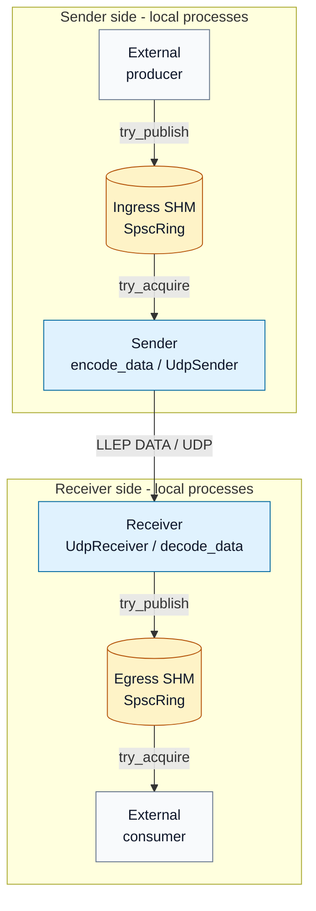

# Current data path

Arrows show the direction of event data. Each SHM ring has one producer and one
consumer. Sender and receiver sides may run on the same host or on different hosts;
the current integration tests exercise loopback delivery through the library API.

[Editable source](current-data-path.mmd) · [PNG preview](current-data-path.png) ·
[Architecture notes](../docs/architecture.md#current-data-path)
