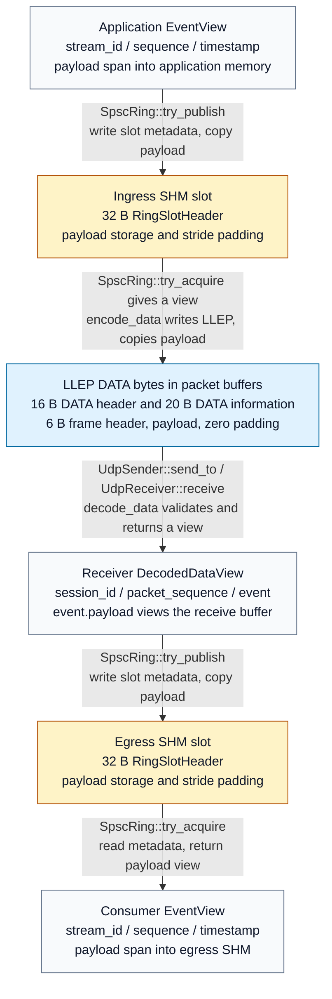

# Event data representations

The current single-event path changes between an application view, a native SHM
slot, and encoded LLEP bytes. The UDP hop uses separate sender and receiver packet
buffers with the same LLEP layout. Acquiring or decoding returns a payload view;
publishing and encoding copy payload bytes.

[Mermaid source](data-representation-flow.mmd) · [PNG preview](data-representation-flow.png) ·
[Field offsets and example](../docs/data-flow.md)
